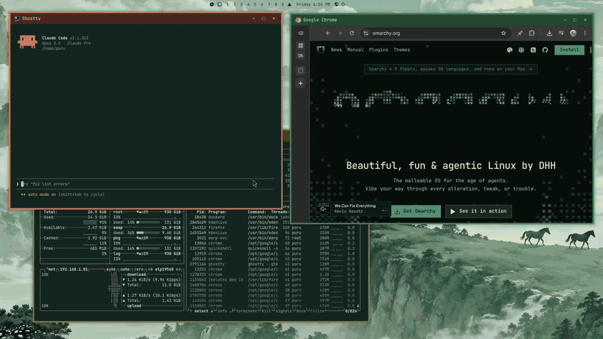

# App Colors for Omarchy

Colours each floating window's border and title bar from its app's icon, so a pile of floating windows is easy to tell apart at a glance: HubSpot orange, YouTube red, Files blue, a terminal running Claude Code in Claude's coral.

[](assets/demo.mp4)

_Click for the full-quality video._

Each app gets one solid colour in three matching shades:

- **Focused border**: the app's colour, softened so it never glares.
- **Unfocused border**: a dimmer shade of it.
- **Title bar**: a deep, muted shade the light title text reads well on.

Tiled windows keep your theme's border. Turn it on and off from the palette button in the bar or with `SUPER + ALT + B`.

## Install

```bash
omarchy pkg add imagemagick   # reads the icons; see Requirements
omarchy plugin add https://github.com/tuladhar/omarchy-appcolor.git --enable
```

Nothing else to set up: the plugin loads its Hyprland part itself, so `hyprland.lua` needs no changes. It never edits your configuration; it adds `SUPER + ALT + B` while it runs.

## Remove

```bash
omarchy plugin remove io.github.tuladhar.appcolor
```

Removing or disabling it hands every border and title bar back to the theme straight away. The plugin keeps its colours in `~/.local/state/appcolor/` and downloaded icons in `~/.cache/appcolor/`; delete those too for a clean slate, along with `~/.config/appcolor/` if you made overrides.

## How it picks colours

- **One-colour brands** (HubSpot, YouTube, Claude) keep their own colour.
- **Multi-colour logos** (Chrome, Gmail, Firefox) take whichever of their own colours sits furthest from your other apps.
- **Black-and-white icons** (Notion, ChatGPT, OBS) take a colour from your Omarchy theme, and are worked out again when you switch theme.
- **Web apps** made with Omarchy's web app installer are recognised whichever Chrome profile opened them.
- **Terminals running Claude Code** are recognised by their title and get Claude's colour.

Colours come from the app's desktop entry icon, looked up in the `hicolor` theme. When an app has no local icon, its icon is downloaded once from the [Dashboard Icons](https://github.com/homarr-labs/dashboard-icons) collection over HTTPS and cached in `~/.cache/appcolor/icons/`. Only the app's name is sent. To turn downloads off, put this in `~/.config/appcolor/config.json`:

```json
{ "downloadIcons": false }
```

## Choosing a colour yourself

Set any app's colour in `~/.config/appcolor/overrides.json`, then run the `rebuild` command below:

```json
{ "web:app.hubspot.com__": ["#ff7a59"], "claude": ["#c15f3c"] }
```

The keys are listed by `list`:

```bash
~/.config/omarchy/plugins/io.github.tuladhar.appcolor/bin/appcolor list
~/.config/omarchy/plugins/io.github.tuladhar.appcolor/bin/appcolor rebuild
```

## Title bars

The title bar colour uses Omarchy's titlebar plugin (`omarchy-hyprland-titlebars`), which draws the bars on floating workspaces. App icons in the title bar, and minimize/maximize/close buttons that take the bar's colour, are proposed in [omacom/omarchy-hyprland-titlebars#21](https://github.com/omacom/omarchy-hyprland-titlebars/pull/21). Until that lands, the buttons keep the theme's colour.

## How it works

- `Service.qml` loads `hypr/appcolor.lua` into Hyprland's Lua with `hyprctl eval`, and again after every config reload.
- `hypr/appcolor.lua` tags each window by app (`appcolor-<app>`) and adds one window rule per app for the focused border and title bar. Hyprland 0.56 does not draw an unfocused border colour set by a rule, so the unfocused shade is set on each floating window as a property.
- `bin/appcolor` finds each app's icon, picks its colour and writes `~/.local/state/appcolor/palette.lua`.
- `AppColor.qml` is the bar button.

Disabling the plugin hands every border back to the theme.

## Requirements

- Omarchy with Hyprland 0.56 or newer.
- ImageMagick, which reads the app icons. Omarchy doesn't include it. Install it with:

  ```bash
  omarchy pkg add imagemagick
  ```

  Check it with `magick -version`. Without it, the plugin shows a notification saying what to install and leaves borders alone.

## License

MIT
